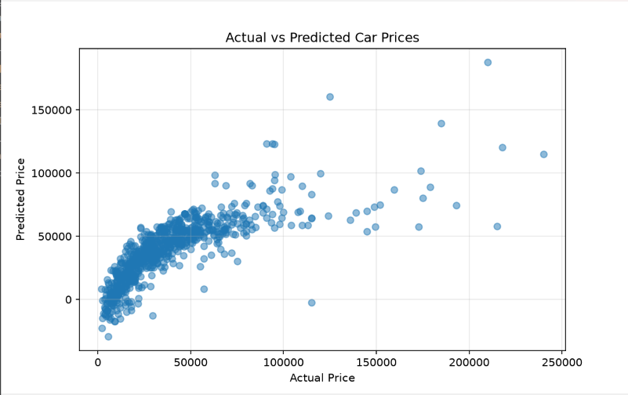
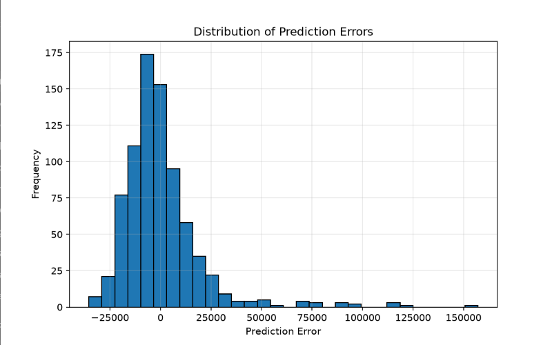

# Used Car Price Prediction

An AI101 mini-project that predicts the estimated selling price of a used car using a Linear Regression model.

  

## Team and roles

| Member | Entry no. | GitHub handle | Role |
|---|---|---|---|
| Gaurav Nikam | 2026AIB1037 | GauravNikam2008 | Documentation lead |
| Jeevan Singh Kharwar | 2026MCB1531 | Jsk1531 | Execution lead |
| Srinidhi Adelli | 2026ESB1496 | srinidhi107-code | PPT lead |
| Thota Chaya Sri Veera Sukesh | 2026EEB1419 | T-SUKESH | Video lead |

All four members contributed to the project. Individual contributions are visible in the repository commit history.

## Project overview

The project predicts a used car's selling price from its year, mileage, and engine-related characteristics.

- **Dataset:** `Used_cars.csv` — used-car listings with brand, model, year, mileage, fuel type, engine, transmission, accident information, and price. <!-- FILL: add dataset source link -->
- **Model:** Linear Regression
- **Target variable:** `price`
- **Train/test split:** 80% training and 20% testing (`random_state=42`)
- **Evaluation:** MAE, MSE, RMSE, R², prediction-error analysis, and feature-importance ranking.

### Features used by the model

The data-preprocessing step cleans price and mileage values, then derives numerical engine features:

- brand value
- model year
- mileage
- horsepower
- engine displacement in litres
- cylinder count
- turbo flag (`0` or `1`)
- electric-vehicle flag (`0` or `1`)

## Project structure

```text
PROJECT-AI/
├── Used_cars.csv                 # source dataset
├── Data_Preprocessing.py         # loading, cleaning, exploration, and EDA charts
├── training.py                   # feature engineering and Linear Regression training
├── Predict.py                    # test-set comparison and interactive price prediction
├── Error.py                      # metrics, error analysis, and feature-importance chart
├── main.py                       # runs the complete workflow
├── price_distribution.png        # EDA: price distribution
├── price_vs_milage.png           # EDA: mileage versus price
├── results/
│   ├── actual_vs_predicted_car_prices.png
│   └── prediction_error_distribution.png
├── Requirements.txt              # Python dependencies
└── README.md
```

## Setup

Use a terminal opened inside the `PROJECT-AI` folder.

### 1. Clone the repository

```bash
git clone https://github.com/Jsk1531/PROJECT-AI.git
cd PROJECT-AI
```

### 2. Create and activate a virtual environment
Activate it by 2nd command
```bash
python -m venv venv

.\venv\Scripts\Activate.ps1
```

- **Command Prompt:** `venv\Scripts\activate`
- **PowerShell:** `venv\Scripts\Activate.ps1`
- **Git Bash on Windows:** `source venv/Scripts/activate`
- **macOS/Linux:** `source venv/bin/activate`

### If it does not activate, Then use this prior to 2nd command 

```bash
Set-ExecutionPolicy -Scope CurrentUser -ExecutionPolicy RemoteSigned
```

### 3. Install the libraries

```bash
pip install numpy pandas matplotlib seaborn scikit-learn joblib
```

## How to run

Run the complete project from the project root:

```bash
python main.py
```

The workflow performs the following steps:

1. Loads `Used_cars.csv`.
2. Cleans the `price` and `milage` columns.
3. Extracts horsepower, engine displacement, cylinders, turbo, and electric flags from engine descriptions.
4. Creates the feature set and splits the data into training and testing portions.
5. Trains the Linear Regression model.
6. Displays a comparison of actual and predicted prices.
7. Prompts the user for car details and prints an estimated selling price.
8. Runs **error management and evaluation** through `Error.py`: MAE, MSE, RMSE, R², a prediction-error table, prediction-error distribution, actual-versus-predicted plot, and feature-importance ranking.

### Interactive prediction inputs

When prompted, enter numerical values for:

| Input | Example |
|---|---:|
| Brand value | 20,000 |
| Model year | 2018 |
| Mileage | 50,000 |
| Horsepower | 200 |
| Engine displacement (litres) | 2.0 |
| Number of cylinders | 4 |
| Turbo engine | `0` for No, `1` for Yes |
| Electric car | `0` for No, `1` for Yes |

NOTE: All the entered values should be reasonable for an appropriate prediction 

## Results

The final workflow evaluates predictions against the actual test-set prices and examines the distribution of prediction errors.

### Actual versus predicted car prices



### Distribution of prediction errors



### Exploratory data analysis

#### Price distribution


#### Price versus mileage


## Error management and interpretation

`Error.py` evaluates the trained model using:

- **MAE:** average absolute difference between actual and predicted prices.
- **MSE:** average squared prediction error.
- **RMSE:** prediction error measured in the same unit as price.
- **R²:** proportion of variation in price explained by the model.

It also produces an error table, an actual-versus-predicted plot, a prediction-error histogram, and a feature-importance ranking based on the Linear Regression coefficients.

## Troubleshooting

| Problem | Fix |
|---|---|
| `python` is not recognized | Install Python and select **Add Python to PATH** during installation. |
| `ModuleNotFoundError` | Activate the virtual environment, then run the install command above. |
| `FileNotFoundError` for `Used_cars.csv` | Run `python main.py` from the `PROJECT-AI` folder. |
| Prediction input fails | Enter numeric values only; use `0` or `1` for turbo and electric fields. |

## Links

- Slides (5): <!-- FILL: add PPT link or file path -->
- Video (maximum 5 minutes): <!-- FILL: add video link -->

## AI-use disclosure


- AI tools were used for explanations, debugging support, and documentation drafting.
- The team reviewed, ran, and verified the final program and its results.
- AI was not used to fabricate dataset values, evaluation metrics, or project results.
